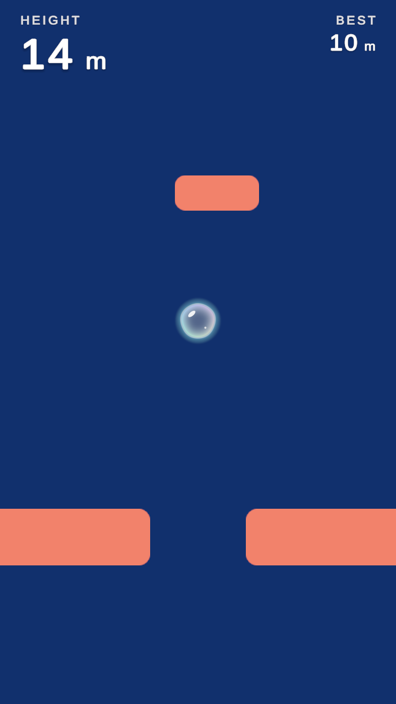

# Bubble Ascent

A one-button mobile game about a soap bubble rising from the sea floor to the sky. Hold to inflate and rise faster,
release to shrink and sink. The camera keeps climbing on its own, so you must keep up, but a big bubble hits things
more easily. This repository is the core mechanic only, kept small and readable.



## How to play

- **Hold** (touch, mouse button, Space or gamepad south button): the bubble inflates and rises, faster the bigger it is.
- **Release**: it shrinks and sinks.
- Gates have a narrow gap that only a small bubble fits through; crossers sweep sideways across the column.
- One hit pops the bubble, and so does falling below the bottom of the screen. Hold again to restart instantly.
- Height and best height are shown; the best is saved on the device.

## Mechanics and engineering notes

- **Plain C# simulation, thin MonoBehaviours.** `BubbleMotor`, `ObstacleField`, `RunSession`, `JourneySettings` and
  `SaveStore` have no scene or frame-loop dependencies and are unit tested. `GameController` only binds input to the
  session and the session's state to the views (`BubbleView`, `ObstaclesView`, `BackgroundView`, `HudView`).
- **Fairness invariant for procedural gates.** The generator derives what is passable from the bubble's own
  capabilities: a gate gap always fits the smallest bubble plus a margin, a crosser's patrol always leaves a window
  for the largest bubble, and consecutive obstacles are spaced by the thickest obstacle plus the largest bubble's
  diameter. Tuning that would break this is raised to the fair value at runtime, and tests check it over 2000 m of
  generated layout, including with deliberately bad settings.
- **Difficulty paced over the whole journey.** Spacing, gap width, gate chance and crosser speed ease from "easy" to
  "hard" along `hardestAtHeight`, and the camera speed grows with the peak height up to a cap that stays below the
  bubble's top rise speed. The journey goes from sea to sky at `surfaceHeight`; in the sky thin air makes the bubble
  inflate slightly on its own (capped so releasing always shrinks it usefully).
- **Deterministic simulation.** Layouts come from a seed; slow frames are split into fixed substeps so a hitch cannot
  skip over an obstacle or a pop.
- **Data-driven tuning.** Every balance number lives in `Assets/_Project/Data/GameTuning.asset`
  (`GameTuning` ScriptableObject), validated in `OnValidate`.
- **No per-frame allocations in steady state.** Obstacle sprites are pooled; the HUD rewrites text only when the
  displayed value changes, through TMP's allocation-free `SetText`.
- **Bubble shader.** `Bubble.shader` draws the bubble procedurally on a quad: clear core thickening toward the rim
  (fresnel), a slowly turning iridescent rim, a gentle edge wobble, highlights, an outline and an outer glow.
- **Robust local save.** Versioned JSON, atomic writes, tolerant loading; a save that exists but cannot be read is
  never overwritten.

## Why it's built this way

Some of this isn't the usual Unity way, so here is the reasoning.

The rules don't live in MonoBehaviours. The bubble, the obstacle generator and the run are plain classes that take a
time step and hand back state. Written as components it would work just as well at this size, but keeping them out of
the frame loop lets a test play a thousand runs in a `for` loop instead of waiting on real time, and one `Tick` updates
everything in an order I can read, instead of depending on script execution order.

There's no Physics2D. The bubble only moves up and down and every obstacle is a rectangle, so a circle-vs-rectangle
check covers it. The bigger reason is fairness: the generator promises that every gap fits the smallest bubble, and
that only holds if the generator and the collision measure the bubble with the same numbers. A collider keeps its own
radius (times the transform's scale), and sooner or later someone tweaks it to match the art and the promise quietly
breaks. If the game ever needed bouncing, stacking or rotation, I'd move to Physics2D.

Layouts come from a seeded `System.Random`, so a seed always gives the same course. A bug report can be replayed, and a
daily challenge where everyone climbs the same course would be cheap to add. Only the layout is reproducible today;
replaying a whole run would also need the input recorded frame by frame.

All the numbers sit in one ScriptableObject, grouped into plain serializable classes, so tests can build their own
values with `new` and there's a single place to tune.

The save is a small JSON file rather than PlayerPrefs. For a single best height PlayerPrefs would honestly be enough; I
went with a versioned file because it survives the format changing later and is easy to test against a temp folder.

The scene is built by an editor script, so its wiring can be read and diffed like any other code. The HUD is the
exception: it's a prefab, because layout is something you want to nudge by eye in the editor. A builder generates it
only when it's missing, so hand edits survive.

The HUD is TextMeshPro on a canvas that scales in Expand mode, inside a panel fitted to the device's safe area. Height
and best each own a fixed share of the top bar, so a long number shrinks instead of running into the other one.

## Tests

EditMode tests cover the bubble rules, obstacle generation and fairness, the run session (camera, popping, restart,
pause, records, sea/sky), the save store and the safe-area math.

```
"C:/Program Files/Unity/Hub/Editor/6000.6.0f1/Editor/Unity.exe" -batchmode -nographics -projectPath . -runTests -testPlatform EditMode -testResults Logs/editmode.xml
```

## Build the scene

`Bubble Ascent > Build Game Scene` recreates `Assets/_Project/Scenes/Game.unity` and the generated sprites from scratch.
`Bubble Ascent > Rebuild HUD Prefab` regenerates `Hud.prefab` (it is otherwise left alone, so edits made in the editor stay).
In batch mode: `-batchmode -quit -nographics -executeMethod BubbleAscent.EditorTools.GameSceneBuilder.Build`.

`Bubble Ascent > Capture Screenshot` plays a scripted run and writes `Docs/screenshot.png` (needs a graphics device, so no
`-nographics`).

## Project layout

```
Assets/
  _Project/
    Art/            Bubble shader and material, generated sprites
    Data/           GameTuning.asset
    Prefabs/        Hud.prefab
    Scenes/         Game.unity
    Scripts/
      Core/         SaveStore
      Data/         GameTuning
      Gameplay/     GameController, Bubble/, Obstacles/, Run/, Background/
      UI/           HudView, SafeAreaFitter
      Editor/       scene and HUD builders, screenshot tool
  Tests/EditMode/   unit tests
```

Unity 6000.6.0f1, Universal 2D (URP 2D renderer), Input System, uGUI with TextMeshPro.
